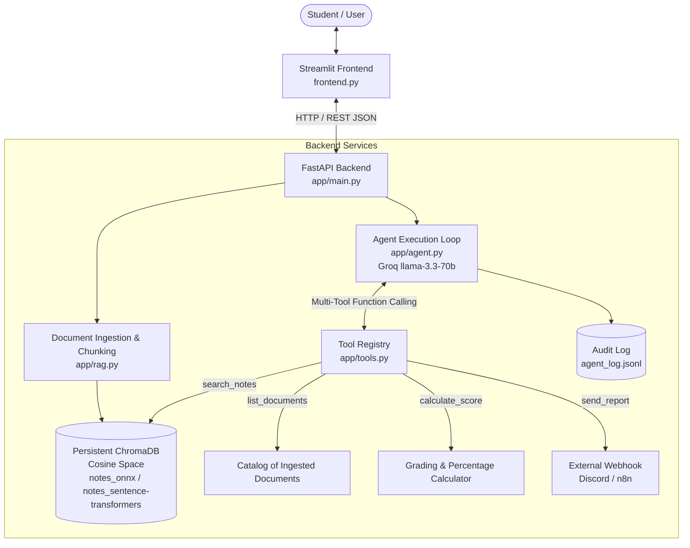

# CampusPrep AI: Autonomous Placement & Study Assistant

CampusPrep AI is a lightweight, full-stack placement preparation assistant designed to help college students master computer science fundamentals, take topic-specific quizzes, track their weak spots, and report their study progress.

## Problem Statement
Students preparing for engineering campus placements struggle to navigate fragmented course notes, lack structured practice question sets tailored to their own syllabus materials, and have difficulty assessing weak areas across foundational core subjects like Operating Systems, Database Management Systems, and Data Structures & Algorithms. CampusPrep AI solves this by transforming static study notes into an interactive, tool-augmented placement coach with semantic search, automated grading, and progress reporting.

---

## Architecture Diagram

The diagram below illustrates the end-to-end data and agent execution flow:



---

## Criteria Fulfillment

### Mandatory Criteria
1. **Working Streamlit Frontend**: Interactive web interface (`frontend.py`) featuring document management in the sidebar (multi-file upload, ingest button, document list) and chat interface displaying assistant answers, cited source chunks with similarity scores, and execution trace expanders. Includes a 120-second timeout with friendly spinners to accommodate free-tier cold starts.
2. **FastAPI Backend with Pydantic Validation and Error Handling**: Modular API (`app/main.py`, `app/schemas.py`) with strict Pydantic schemas validating payloads (`AgentRequest`, `ChatTurn`, `AgentResponse`, `UploadResponse`), global error handlers returning clean JSON without stack traces, and CORS support.
3. **RAG with sentence-transformers Embeddings & Persistent ChromaDB**: Implemented in `app/rag.py` and `app/embeddings.py` using ChromaDB with cosine similarity (`hnsw:space: cosine`). Documents (`.txt`, `.md`, `.pdf`) are chunked to ~500 characters with 50-character overlap.
4. **Agentic Execution via Multi-Tool Groq Function Calling**: Powered by Groq's `llama-3.3-70b-versatile` in `app/agent.py` executing an autonomous tool-calling loop (up to 5 rounds) over 4 registered tools: `search_notes`, `list_documents`, `calculate_score`, and `send_report`.
5. **Live Deployment Readiness**:
   - Backend configured for Render Free Tier (512 MB RAM, ephemeral disk).
   - Frontend configured for Streamlit Community Cloud.

### Distinction Criteria
- **API Rate Limiting**: Implemented via `slowapi` with client IP resolution through `X-Forwarded-For` header inspection (10 req/min on `/agent`, 5 req/min on `/upload`), returning standard HTTP 429 JSON responses.
- **Environment Secrets Management**: API keys and endpoints (`GROQ_API_KEY`, `WEBHOOK_URL`, `EMBEDDING_BACKEND`) managed through `.env` and `python-dotenv`, with `.env.example` provided and `.env` strictly git-ignored.
- **Visible Agent Execution Logs**: Tool invocations and previews are rendered in real time within Streamlit expanders and permanently recorded to `agent_log.jsonl`, viewable via `GET /logs`.
- **Webhook Action**: `send_report` tool POSTs session summaries to Discord, Slack, or n8n webhooks, gracefully handling unconfigured endpoints.

---

## Embedding Backends: Production vs. Local

- **Production (Default - ONNX Runtime)**: In production environments like Render Free Tier (capped at 512 MB RAM), heavyweight PyTorch runtimes cause out-of-memory (OOM) termination. By default, `app/embeddings.py` uses ChromaDB's `DefaultEmbeddingFunction()`, executing the `all-MiniLM-L6-v2` model via ONNX Runtime without torch, keeping RAM well under 250 MB.
- **Local (Literal sentence-transformers)**: For local testing with the literal `sentence-transformers` library, install `requirements-local.txt` and set `EMBEDDING_BACKEND=sentence-transformers`. The database isolates vectors into separate collections (`notes_onnx` vs. `notes_sentence-transformers`) to prevent vector space contamination.

---

## Free-Tier Ephemeral Disk & Cold-Start Notice

Render free-tier web services automatically spin down after 15 minutes of inactivity and possess ephemeral storage (the filesystem resets on reboot). CampusPrep AI handles this seamlessly:
- On startup, the lifespan event handler checks if the ChromaDB collection is empty.
- If empty, it automatically re-ingests all baseline subject materials located in `data/`.
- The frontend uses a 120-second timeout with an informative spinner to allow sleeping backend instances to warm up.

---

## Local Development Quickstart

### 1. Setup Virtual Environment
```powershell
python -m venv .venv
.\.venv\Scripts\Activate.ps1
pip install -r requirements.txt
```
*(For local PyTorch sentence-transformers: `pip install -r requirements-local.txt`)*

### 2. Configure Environment Variables
Copy `.env.example` to `.env` and add your Groq API key:
```env
GROQ_API_KEY=your_groq_api_key_here
WEBHOOK_URL=https://discord.com/api/webhooks/...  # Optional
EMBEDDING_BACKEND=onnx
```

### 3. Run FastAPI Backend
```powershell
uvicorn app.main:app --reload
```
The API docs will be accessible at `http://localhost:8000/docs`.

### 4. Run Streamlit Frontend
In a separate terminal:
```powershell
streamlit run frontend.py
```
Open `http://localhost:8501` in your browser.

---

## Environment Variables Reference

| Variable | Default | Purpose |
| :--- | :--- | :--- |
| `GROQ_API_KEY` | *(Required)* | Groq Cloud API authentication key |
| `WEBHOOK_URL` | *(Optional)* | Discord or n8n webhook URL for the `send_report` action |
| `EMBEDDING_BACKEND` | `onnx` | `onnx` for lightweight deployment, `sentence-transformers` for local torch |
| `BACKEND_URL` | `http://localhost:8000` | Frontend target URL pointing to FastAPI backend |

---

## Deployment Settings

### Render (FastAPI Backend)
- **Service Type**: Web Service (Free Tier)
- **Repository**: Your forked repository
- **Branch**: `athul-pp`
- **Root Directory**: `athul-pp` *(or blank if repository is built at root)*
- **Build Command**: `pip install -r requirements.txt`
- **Start Command**: `uvicorn app.main:app --host 0.0.0.0 --port $PORT`
- **Environment Variables**:
  - `GROQ_API_KEY`: `<your-groq-api-key>`
  - `WEBHOOK_URL`: `<optional-webhook-url>`
  - `EMBEDDING_BACKEND`: `onnx`
- **Health Check Path**: `/health`

### Streamlit Community Cloud (Frontend)
- **Repository**: Your forked repository
- **Branch**: `athul-pp`
- **Main file path**: `athul-pp/frontend.py` *(or `frontend.py` if root)*
- **App Secrets**:
  ```toml
  BACKEND_URL = "https://your-render-service.onrender.com"
  ```

---

## Capstone Submission Links

Live Frontend URL: TBD
Live Backend API URL: TBD
