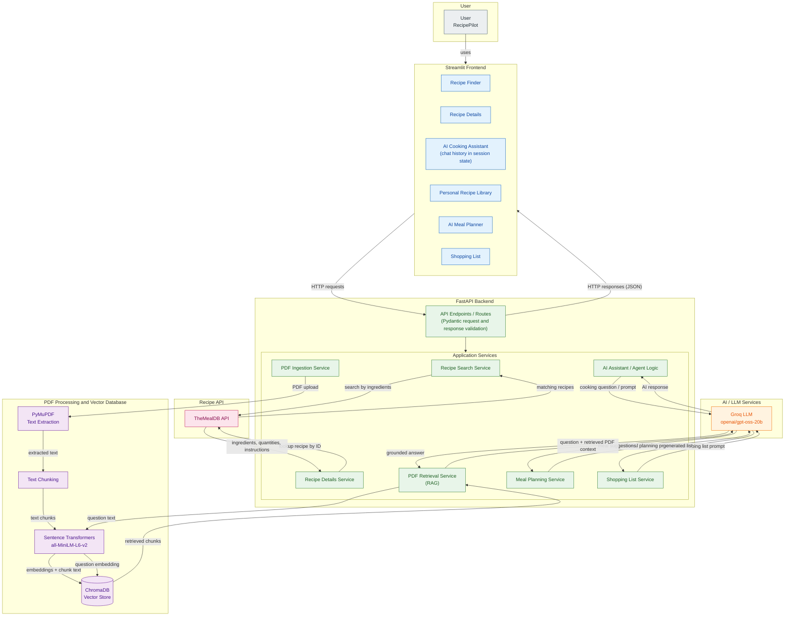

# 🍳 RecipePilot – AI-Powered Recipe Assistant


## Project Overview

RecipePilot is an AI-powered recipe assistant that helps users discover recipes, understand cooking instructions, organize personal recipes, and get cooking assistance through natural language conversations.

It combines recipe discovery through an external API with Large Language Models (LLMs) and Retrieval-Augmented Generation (RAG) to provide an interactive cooking experience.

## Problem Statement

Deciding what to cook with the ingredients available at home can be challenging. Users often spend time searching multiple websites for suitable recipes, understanding cooking instructions, planning meals, and maintaining personal recipe collections.

Traditional recipe platforms mainly provide predefined recipes and limited interaction. They may not offer personalized conversational assistance or allow users to retrieve information from their own recipe documents.

RecipePilot addresses these challenges by bringing recipe discovery, AI-powered cooking assistance, personal recipe management, PDF-based question answering, meal planning, and shopping-list generation into one application.

---

## Features

### 1. Recipe Finder
- Search for recipes using available ingredients.
- Retrieve matching recipes using TheMealDB API.
- Explore available recipe information.

### 2. Recipe Details
- View recipe ingredients and quantities.
- Read cooking instructions.
- Explore individual recipes.

### 3. AI Cooking Assistant
- Ask cooking-related questions using natural language.
- Receive AI-generated cooking suggestions and explanations.
- Maintain conversation history during the session.

### 4. Personal Recipe Library
- Upload PDF documents containing recipes.
- Extract text from uploaded documents.
- Manage uploaded recipe documents.

### 5. PDF-Based Question Answering
- Retrieve relevant information from uploaded recipe PDFs.
- Use retrieved content as context for AI-generated answers.
- Ask questions about personal recipe documents using RAG.

### 6. AI Meal Planner
- Generate meal-planning suggestions using AI.

### 7. Shopping List
- Generate shopping lists based on meal-planning requirements.

---

## Architecture

RecipePilot follows a client-server architecture consisting of a Streamlit frontend and a FastAPI backend.


### Frontend – Streamlit

The frontend provides the user interface for recipe searching, viewing recipe details, interacting with the AI assistant, uploading recipe documents, generating meal plans, and managing shopping lists.

### Backend – FastAPI

The backend handles API requests, application logic, communication with external services, and AI-related operations. Pydantic is used for request and response validation.

### AI Integration – Groq

Groq provides access to the Large Language Model used for conversational cooking assistance and other AI-powered features.

### Recipe Data – TheMealDB

TheMealDB API is integrated to retrieve recipe information based on ingredients provided by users.

### Retrieval-Augmented Generation (RAG)

The Recipe Library supports PDF uploads. PyMuPDF extracts text from uploaded documents. Sentence Transformers converts the extracted text into embeddings, which are stored in ChromaDB.

When a user asks a question about uploaded recipes, the system retrieves relevant information from the vector database and provides it as context to the LLM to generate an answer.

### Frontend and Backend Communication

The Streamlit frontend communicates with the FastAPI backend through HTTP requests. The backend processes the requests and returns responses to the frontend for display.

---
## 📁 Project Structure

```text
sree-lekshmi-h/
│
├── backend/
│   └── app/
│       ├── agents/
│       ├── api/
│       ├── schemas/
│       ├── services/
│       └── main.py
│
├── frontend/
│   ├── pages/
│   ├── app.py
│   ├── api_client.py
│   └── hero_slideshow.py
│
├── .env.example
├── .gitignore
├── requirements.txt
└── README.md

```
## Concept Breakdown

| Concept | Implementation in RecipePilot |
|---|---|
| API Integration | TheMealDB for recipe search and information |
| LLM Integration | Groq for AI-generated responses |
| Retrieval-Augmented Generation | Retrieving relevant information from uploaded recipe PDFs |
| Text Extraction | PyMuPDF for extracting text from PDFs |
| Text Embeddings | Sentence Transformers (`all-MiniLM-L6-v2`) |
| Vector Database | ChromaDB for storing and retrieving embeddings |
| Client-Server Architecture | Streamlit frontend communicating with FastAPI backend |
| Data Validation | Pydantic |

---

## Technology Stack

| Category | Technologies |
|---|---|
| Programming Language | Python |
| Frontend | Streamlit |
| Backend | FastAPI |
| API Server | Uvicorn |
| LLM | Groq (`openai/gpt-oss-20b`) |
| Recipe API | TheMealDB |
| Embeddings | Sentence Transformers |
| Vector Database | ChromaDB |
| PDF Processing | PyMuPDF |
| Data Validation | Pydantic |
| HTTP Communication | HTTPX, Requests |
| Environment Configuration | Python-dotenv |

---

## Application Screenshots

The following screenshots demonstrate the main interfaces and features of RecipePilot.

### Home Page


### Recipe Finder


### Recipe Details


### AI Cooking Assistant


### Recipe Library


### AI Meal Planner


### Shopping List


---

## Installation and Setup

### Prerequisites

- Python 3.10 or later
- Git
- Groq API key

### 1. Clone the Repository

```bash
git clone YOUR_GITHUB_REPOSITORY_URL
cd YOUR_PROJECT_FOLDER
```

### 2. Create a Virtual Environment

```bash
python -m venv venv
```

Activate the environment on Windows:

```powershell
venv\Scripts\activate
```

### 3. Install Dependencies

```bash
pip install -r requirements.txt
```

### 4. Configure Environment Variables

Create a `.env` file in the project root:

```env
GROQ_API_KEY=your_groq_api_key
```

Replace the placeholder with your actual Groq API key.

**Important:** Never upload your actual `.env` file or API key to GitHub.

### 5. Run the Backend

From the project root, execute:

```bash
uvicorn backend.app.main:app --reload
```

The FastAPI documentation will be available at:

http://127.0.0.1:8000/docs

### 6. Run the Frontend

Open a separate terminal, activate the virtual environment, and execute:

```bash
streamlit run frontend/app.py
```

The RecipePilot application will open in your browser.

---

## Project Demonstration

Video demonstration of RecipePilot running locally:

[Watch RecipePilot Demo](https://youtu.be/nH6msVJ7EX8)

---

## Environment Variables

| Variable | Description |
|---|---|
| `GROQ_API_KEY` | API key used to access Groq |

---

## Project Information

**Project Name:** RecipePilot

**Project Type:** AI-Powered Recipe Assistant

**Domain:** Artificial Intelligence and Full-Stack Development

**Developed Using:** Python, Streamlit, FastAPI, Groq, ChromaDB and TheMealDB
```
