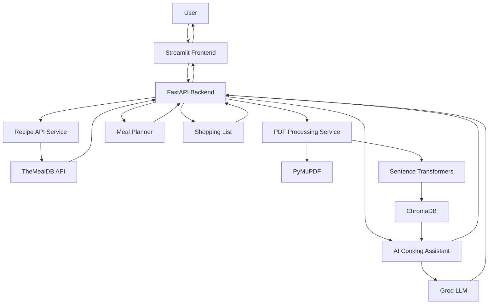

# 🍳 RecipePilot – AI-Powered Recipe Assistant

RecipePilot is an AI-powered recipe assistant designed to make cooking easier, smarter, and more organized. It helps users discover recipes based on available ingredients, explore cooking instructions, interact with an AI cooking assistant, and manage their personal recipe collection.

The application combines external recipe data, Large Language Models (LLMs), and Retrieval-Augmented Generation (RAG) to provide an interactive cooking experience.

---

## 📌 Problem Statement

People often struggle to decide what to cook with the ingredients available at home. Finding suitable recipes, understanding cooking instructions, planning meals, and organizing personal recipes across different sources can be time-consuming.

Traditional recipe platforms mainly provide predefined recipes and limited interaction. They do not necessarily offer personalized conversational assistance or the ability to retrieve information from a user's own recipe documents.

**RecipePilot addresses these challenges** by bringing recipe discovery, AI-powered cooking assistance, PDF-based recipe retrieval, meal planning, and shopping-list generation into a single application.

---

## ✨ Key Features

### 1. Recipe Finder
- Search for recipes using available ingredients.
- Retrieve recipes using TheMealDB API.
- Explore matching recipes and their details.

### 2. Recipe Details
- View recipe ingredients and quantities.
- Read cooking instructions.
- Explore individual recipes.

### 3. AI Cooking Assistant
- Ask cooking-related questions in natural language.
- Get AI-generated cooking suggestions and explanations.
- Maintain conversation history during the session.

### 4. Personal Recipe Library
- Upload PDF documents containing recipes.
- Extract text from uploaded PDF files.
- Manage uploaded recipe documents.

### 5. PDF-Based Question Answering (RAG)
- Retrieve relevant information from uploaded recipe documents.
- Generate answers using retrieved context and an LLM.
- Ask questions about personal recipe collections.

### 6. AI Meal Planner
- Generate meal-planning suggestions using AI.

### 7. Shopping List
- Generate shopping lists based on meal-planning requirements.

---

## 🏗️ Architecture

RecipePilot follows a client-server architecture with a Streamlit frontend and FastAPI backend.



### Architecture Components

| Component | Technology | Responsibility |
|---|---|---|
| Frontend | Streamlit | User interface and interaction |
| Backend | FastAPI | API endpoints and application logic |
| Data Validation | Pydantic | Request and response validation |
| LLM | Groq | AI-generated responses |
| Recipe API | TheMealDB | Recipe search and information |
| PDF Processing | PyMuPDF | Extracting text from PDF files |
| Embeddings | Sentence Transformers | Converting text into vector embeddings |
| Vector Database | ChromaDB | Storing and retrieving recipe information |

---

## 🧠 Concept Breakdown

### 1. External API Integration
RecipePilot integrates with TheMealDB to retrieve recipe information based on user-provided ingredients.

### 2. Large Language Models
Groq provides access to the LLM used for conversational cooking assistance, meal-planning suggestions, and AI-generated responses.

### 3. Retrieval-Augmented Generation (RAG)
The Recipe Library supports PDF uploads. PyMuPDF extracts text from documents, Sentence Transformers generates embeddings, and ChromaDB stores the vector representations.

When a user asks a question related to uploaded recipes:
1. The question is processed.
2. Relevant information is retrieved from ChromaDB.
3. Retrieved context is provided to the LLM.
4. The LLM generates a context-aware response.

### 4. Client-Server Communication
The Streamlit frontend communicates with the FastAPI backend through HTTP requests. The backend handles API operations, external service integration, and AI processing.

---

## 🛠️ Technology Stack

**Frontend**
- Python
- Streamlit

**Backend**
- Python
- FastAPI
- Pydantic
- Uvicorn

**AI and RAG**
- Groq
- Sentence Transformers
- ChromaDB
- PyMuPDF

**External API**
- TheMealDB

**Other Libraries**
- HTTPX
- Requests
- Python-dotenv

---

## 📸 Application Screenshots

Screenshots of the application are provided below.

> Create a folder named `screenshots` in your project directory and place your screenshots inside it. Replace the example filenames below with your actual image filenames.

### 1. Home Page


### 2. Recipe Finder


### 3. Recipe Details


### 4. AI Cooking Assistant


### 5. Recipe Library


### 6. AI Meal Planner


### 7. Shopping List


---

## ⚙️ Installation and Setup

### Prerequisites
- Python 3.10 or later
- Git
- Groq API key

### 1. Clone the Repository

```bash
git clone YOUR_GITHUB_REPOSITORY_URL
cd YOUR_PROJECT_FOLDER
```

### 2. Create a Virtual Environment

```bash
python -m venv venv
```

Activate it on Windows:

```powershell
venv\Scripts\activate
```

### 3. Install Dependencies

```bash
pip install -r requirements.txt
```

### 4. Configure Environment Variables

Create a `.env` file in the project root:

```env
GROQ_API_KEY=your_groq_api_key
```

Do not commit your actual `.env` file or API key to GitHub.

### 5. Start the Backend

From the project root:

```bash
uvicorn backend.app.main:app --reload
```

FastAPI documentation:

```text
http://127.0.0.1:8000/docs
```

### 6. Start the Frontend

Open another terminal:

```bash
streamlit run frontend/app.py
```

The Streamlit application will open in your browser.

---

## 🎥 Project Demonstration

RecipePilot demonstration video:

[Watch RecipePilot Demo](https://youtu.be/nH6msVJ7EX8)

---

## 🔐 Environment Variables

| Variable | Description |
|---|---|
| `GROQ_API_KEY` | API key used to access Groq |

---

## 👩‍💻 Project Information

**Project:** RecipePilot – AI-Powered Recipe Assistant

**Category:** Artificial Intelligence / Full-Stack Development

**Developed using:** Python, Streamlit, FastAPI, Groq, ChromaDB and TheMealDB

---

